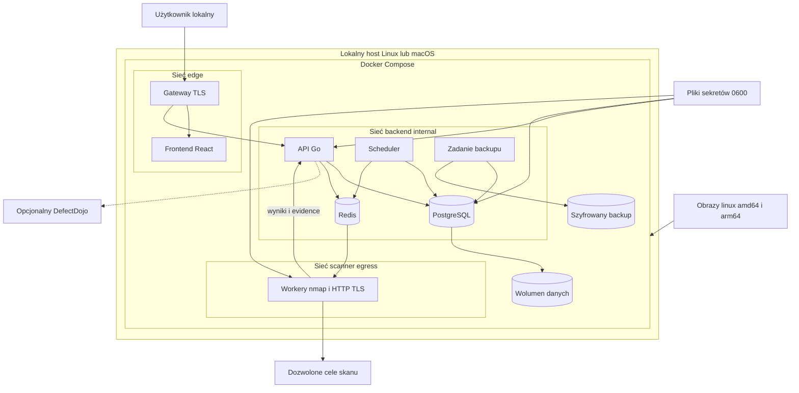

# Architektura

## Założenia

Attack Surface Intelligence jest uruchamiane lokalnie przez Docker Compose. Ten sam zestaw obrazów obsługuje `linux/amd64` i `linux/arm64`, w tym Docker Desktop na komputerach Mac z procesorem Intel lub Apple Silicon.

System rozdziela warstwę zarządzającą od wykonania skanów. API nie uruchamia nmap bezpośrednio, a workery nie mają dostępu administracyjnego do PostgreSQL ani do środowiska kontenerowego.

## Komponenty

### Gateway

Jedyny punkt wejścia wystawiony poza sieci Docker Compose. Terminuje TLS, serwuje frontend oraz przekazuje żądania API. Pozostałe usługi nie publikują portów na hoście.

### Frontend

Aplikacja React/TypeScript udostępniająca:

- dashboard;
- zarządzanie celami i konfiguracją skanów;
- import oraz eksport;
- podgląd historii i różnic;
- edycję wyników;
- zarządzanie sygnaturami;
- interfejs dostosowany do uprawnień użytkownika.

### API

Usługa Go odpowiadająca za:

- uwierzytelnianie i RBAC;
- walidację danych wejściowych;
- zarządzanie celami, profilami i harmonogramami;
- trwałe ręczne nadpisania;
- przyjmowanie wyników workerów;
- porównywanie obserwacji;
- eksport CSV/JSON i integrację DefectDojo;
- audyt zmian.

API jest jedynym komponentem zapisującym wyniki workerów do PostgreSQL.

### Scheduler

Scheduler:

- wyznacza terminy skanów;
- zapisuje snapshot konfiguracji przebiegu;
- rozwija i deduplikuje cele;
- dzieli pracę na idempotentne batche;
- pilnuje deadline okna;
- zatrzymuje i wznawia pracę;
- oblicza postęp oraz ETA.

Scheduler może korzystać z tego samego obrazu co API, ale działa jako oddzielny proces i usługa Compose.

### Redis

Redis przechowuje:

- kolejkę zadań;
- lease workerów;
- retry i informacje o zadaniach aktywnych;
- sesje użytkowników;
- krótkotrwałe blokady koordynacyjne.

Redis nie jest źródłem prawdy. Po jego utracie scheduler odtwarza brakujące zadania na podstawie PostgreSQL.

### Worker

Worker wykonuje:

- discovery nmap;
- identyfikację portów i usług;
- HTTP/HTTPS fingerprinting;
- analizę TLS;
- customowe sygnatury;
- bezpieczne zbieranie evidence.

Worker otrzymuje jedynie token umożliwiający pobieranie zadań i przesyłanie wyników. Nie posiada poświadczeń administracyjnych bazy ani dostępu do socketu Dockera.

Na zgodnym Linuksie worker używa SYN scan. Na Docker Desktop lub bez raw sockets przechodzi na TCP connect scan. Tryb skanu jest zapisany przy wyniku.

### PostgreSQL

PostgreSQL przechowuje:

- konfigurację;
- snapshoty przebiegów;
- obserwacje;
- evidence;
- ręczne overrides;
- historię zmian;
- użytkowników i role;
- log audytowy.

Wrażliwe pola są szyfrowane przez aplikację AES-256-GCM przed zapisem.

### Backup

Oddzielne zadanie Compose tworzy szyfrowany backup PostgreSQL. Backup trafia do osobnego wolumenu lub wskazanego katalogu lokalnego. Skrypt testowy odtwarza go do tymczasowej bazy i wykonuje migracje oraz zapytanie kontrolne.

## Sieci

### `edge`

Łączy gateway z frontendem. Gateway posiada również kontrolowane połączenie z API.

### `backend`

Sieć oznaczona jako `internal`, przeznaczona dla API, schedulera, Redis, PostgreSQL i zadania backupu. PostgreSQL i Redis nie są publikowane na hoście.

### `scanner`

Sieć z kontrolowanym wyjściem do dozwolonych celów. Podłączone są do niej wyłącznie workery. API, frontend, Redis i PostgreSQL nie mają dostępu do sieci skanowanej.

## Przepływ skanu

1. Operator dodaje cele i konfigurację.
2. API waliduje dane i zapisuje je w PostgreSQL.
3. Scheduler tworzy snapshot przebiegu i batche.
4. Batche trafiają do Redis.
5. Worker pobiera zadanie i ponownie waliduje cel.
6. Worker uruchamia nmap i fingerprinting.
7. Wynik wraz z evidence trafia do wewnętrznego API.
8. API normalizuje i szyfruje dane wrażliwe.
9. Silnik różnic porównuje obserwację z poprzednim pełnym przebiegiem.
10. Dashboard pokazuje wynik, stan i poziom pewności.

## Separacja bezpieczeństwa

- Gateway jest jedyną usługą wystawioną na hoście.
- PostgreSQL i Redis działają wyłącznie w sieci wewnętrznej.
- Worker jest jedynym komponentem z wyjściem skanującym.
- Tylko worker może otrzymać `NET_RAW`.
- `NET_ADMIN` jest wyłączone, dopóki konkretny test nie wykaże konieczności.
- Żadna usługa nie montuje socketu Dockera.
- Kontenery używają `no-new-privileges`, limitów procesów oraz read-only filesystem tam, gdzie to możliwe.
- Sekrety są montowane z lokalnych plików `0600`.

## Wieloarchitekturowość

Własne obrazy są budowane przez `docker buildx bake` dla:

- `linux/amd64`;
- `linux/arm64`.

Kod Go jest kompilowany dla `TARGETOS/TARGETARCH` bez zależności wymagających CGO. nmap pochodzi z repozytorium pakietów obrazu bazowego dla właściwej architektury. Frontend jest zestawem statycznych plików niezależnych od CPU.

Ten sam commit musi przejść build, migracje, healthcheck, logowanie, import, testowy skan i eksport na obu architekturach.

## Ograniczenia MVP

- Docker Compose nie zapewnia wysokiej dostępności.
- Awaria lokalnego hosta zatrzymuje wszystkie usługi.
- Redis i PostgreSQL działają jako pojedyncze instancje.
- Docker Desktop nie zapewnia identycznej semantyki sieci jak natywny Linux, dlatego worker wykorzystuje TCP connect scan.
- DefectDojo pozostaje integracją opcjonalną.

Ograniczenia są akceptowalne dla lokalnego prototypu konkursowego i muszą być jawnie opisane podczas demonstracji.
