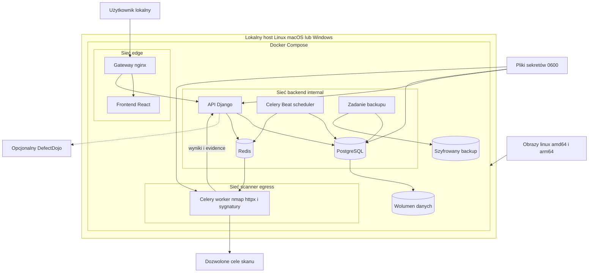

# Architektura

## Założenia

Attack Surface Intelligence jest uruchamiane lokalnie przez Docker Compose. Ten sam zestaw obrazów Linux obsługuje `linux/amd64` i `linux/arm64`, w tym Docker Desktop na macOS (Intel/Apple Silicon) oraz Windows 10/11 z WSL2. Szczegóły hostów opisuje `docs/local-platforms.md`.

System rozdziela warstwę zarządzającą od wykonania skanów. API nie uruchamia nmap bezpośrednio, a workery nie mają dostępu administracyjnego do PostgreSQL ani do środowiska kontenerowego.



## Komponenty

### Gateway

Jedyny punkt wejścia SurfaceX wystawiony poza sieci Docker Compose (HTTP, port `8080`). Serwuje frontend, przekazuje żądania `/api/` i `/admin/` do API oraz zwraca `404` dla `/api/internal/`. Przy niedostępnym API pokazuje stronę przerwy technicznej zamiast surowego błędu 502. Gateway nie terminuje TLS — przy wdrożeniu współdzielonym TLS należy zakończyć na zewnętrznym reverse proxy i ustawić `SECURE_COOKIES=1` oraz `CSRF_PROTECT=1`.

Poza gatewayem porty na hoście publikują tylko: opcjonalny nginx DefectDojo (`8081`) i cel demonstracyjny `lab-target` (`18088`).

### Frontend

Aplikacja React/TypeScript udostępniająca:

- dashboard;
- zarządzanie celami i konfiguracją skanów;
- moduł Passive discovery (crt.sh + RDAP) w przebiegu skanu;
- import oraz eksport;
- podgląd historii i różnic;
- edycję wyników (tagi, notatki, nadpisania);
- zarządzanie użytkownikami, allowlistą, grupami i harmonogramami;
- interfejs dostosowany do uprawnień użytkownika, w języku polskim i angielskim, z trybem ciemnym i wysokiego kontrastu.

### API

Aplikacja Django / Django REST Framework odpowiadająca za:

- uwierzytelnianie i RBAC;
- walidację danych wejściowych;
- zarządzanie celami, profilami i harmonogramami;
- pasywne rozpoznanie przez publiczne CRT/RDAP (cache Redis, bez auto-skanu);
- trwałe ręczne nadpisania;
- przyjmowanie wyników workerów;
- porównywanie obserwacji;
- eksport CSV/JSON i integrację DefectDojo;
- audyt zmian;
- migracje ORM i admin panel wyłącznie dla `admin`.

API jest jedynym komponentem zapisującym wyniki workerów do PostgreSQL. Zapytania CRT/RDAP wychodzą z kontenera API (nie z workera skanującego).

### Scheduler

Celery Beat publikuje dwa zadania okresowe do kolejki `scan`:

- `scans.reconcile_batches` (domyślnie co 60 s) — odtwarza osierocone batche i wstrzymuje przebiegi po przekroczeniu okna;
- `scans.dispatch_schedules` (co 60 s) — uruchamia należne harmonogramy grup.

Oba zadania wykonuje worker, wywołując wewnętrzne endpointy API; właściwa logika (snapshot konfiguracji, tworzenie batchy, pilnowanie okna, postęp i ETA) działa w API na danych z PostgreSQL. Scheduler korzysta z tego samego obrazu co API, ale działa jako oddzielny proces w Compose.

### Redis

Redis przechowuje:

- kolejkę zadań Celery i wyniki zadań;
- cache aplikacji (m.in. tymczasowe tokeny MFA, wyniki zapytań pasywnych);
- identyfikator epoki brokera.

Sesje użytkowników są przechowywane w PostgreSQL. Redis działa bez trwałości (`--save "" --appendonly no`).

Redis nie jest źródłem prawdy; trwałe statusy przebiegów i batchy znajdują się w PostgreSQL. Celery Beat uruchamia reconciler domyślnie co 60 sekund. Broker przechowuje identyfikator swojej bieżącej epoki, a API zapamiętuje go w PostgreSQL. Zmiana epoki po utracie danych Redis powoduje ponowne opublikowanie wszystkich aktywnych batchy; bez zmiany epoki odzyskiwane są tylko zadania `running` bez aktualizacji od co najmniej 10 minut oraz wcześniejsze nieudane publikacje naprawcze. Reconciler nadaje zadaniu nowy `delivery_id`, unieważniając stare komunikaty i blokując zapis wyniku przez nieaktualną kopię zadania. Progi i limit jednej iteracji można zmienić przez `SCAN_RECONCILE_INTERVAL_SECONDS`, `SCAN_RECONCILE_STALE_SECONDS` i `SCAN_RECONCILE_BATCH_LIMIT`.

### Worker

Proces Celery worker wykonuje:

- discovery nmap;
- identyfikację portów i usług;
- wsadowe sondowanie HTTP/HTTPS przez ProjectDiscovery httpx;
- analizę TLS i wstępną detekcję technologii z JSONL httpx;
- customowe sygnatury;
- normalizację evidence i obliczanie confidence score;
- bezpieczne zbieranie evidence.

Worker otrzymuje jedynie token umożliwiający pobieranie zadań i przesyłanie wyników. Nie posiada poświadczeń administracyjnych bazy ani dostępu do socketu Dockera. Zadania Celery są publikowane przez Redis; wynik trafia z powrotem do API HTTP, a nie przez bezpośredni zapis ORM z sieci `scanner`.

Na zgodnym Linuksie worker używa SYN scan. Na Docker Desktop lub bez raw sockets przechodzi na TCP connect scan. Tryb skanu jest zapisany przy wyniku. Domyślne profile portów, limity i flagi httpx opisuje `docs/scanning-policy.md`.

Pipeline workera:

```text
nmap → endpointy HTTP(S) → httpx JSONL → własne sygnatury → evidence → confidence score
```

httpx jest uruchamiany dla partii endpointów, a jego JSONL jest przetwarzany strumieniowo w Pythonie. Wersja narzędzia, użyte opcje i limity trafiają do metadanych przebiegu. Detekcje technologii są dowodami wejściowymi dla wspólnego modelu pewności, a nie bezwarunkowym wynikiem.

Własny moduł Pythona uzupełnia dane wymagane przez deklaratywne sygnatury, w szczególności nazwy cookies, hash favicony i ograniczone fragmenty HTML. WhatWeb oraz Nuclei nie są obowiązkowymi elementami architektury MVP.

WhatWeb może zostać dodany w przyszłości jako opcjonalny, domyślnie wyłączony drugi etap dla ręcznie wybranych endpointów wymagających głębszej identyfikacji. Nie może działać dla całego zakresu bez osobnego limitu ruchu ani przyjmować pluginów dostarczonych przez użytkownika. Jego wyniki muszą zostać zapisane jako evidence i ocenione przez ten sam model pewności co wyniki httpx. Uzasadnienie wyboru opisuje `docs/adr-001-http-fingerprinting.md`.

### PostgreSQL

PostgreSQL przechowuje:

- konfigurację;
- snapshoty przebiegów;
- obserwacje;
- evidence;
- ręczne overrides;
- historię zmian;
- użytkowników i role;
- log audytowy.

Wrażliwe pola są szyfrowane przez aplikację AES-256-GCM przed zapisem.

### Backup

Oddzielne zadanie Compose tworzy szyfrowany backup PostgreSQL. Backup trafia do osobnego wolumenu lub wskazanego katalogu lokalnego. Skrypt testowy odtwarza go do tymczasowej bazy i wykonuje migracje oraz zapytanie kontrolne.

### DefectDojo

Opcjonalny profil `defectdojo` uruchamia przypiętą wersję DefectDojo wraz z nginx, uWSGI, workerem Celery, Celery Beat, osobnym PostgreSQL i Valkey. Dane i media znajdują się w oddzielnych wolumenach, a usługi pomocnicze są odseparowane w wewnętrznej sieci `defectdojo`.

API SurfaceX uwierzytelnia się tokenem lub kontem lokalnego administratora i wysyła ukończone obserwacje przez `reimport-scan` jako `Generic Findings Import`. DefectDojo nie jest wymagane do uruchomienia skanera ani interfejsu SurfaceX.

## Sieci

### `edge`

Łączy gateway z frontendem. Gateway posiada również kontrolowane połączenie z API.

### `backend`

Sieć oznaczona jako `internal`, przeznaczona dla API, schedulera, Redis, PostgreSQL i zadania backupu. Dołączone są do niej także gateway (ruch do API) i worker (kolejka Redis oraz wewnętrzne API). PostgreSQL i Redis nie są publikowane na hoście.

### `scanner`

Sieć `172.30.0.0/24` z wyjściem do skanowanych celów. Podłączone są do niej wyłącznie worker oraz cel demonstracyjny `lab-target` (`172.30.0.10`). API, frontend, Redis i PostgreSQL nie mają dostępu do sieci skanowanej.

### `defectdojo`

Wewnętrzna sieć dla aplikacji DefectDojo, jej workera, schedulera, PostgreSQL i Valkey. Tylko nginx DefectDojo łączy tę sieć z `edge` i kontrolowanym połączeniem z API SurfaceX.

## Przepływ skanu

1. Operator dodaje cele i konfigurację.
2. API waliduje dane i zapisuje je w PostgreSQL.
3. Scheduler tworzy snapshot przebiegu i batche.
4. Batche trafiają do Redis.
5. Worker pobiera zadanie i ponownie waliduje cel.
6. Worker uruchamia nmap, przekazuje wykryte endpointy HTTP/HTTPS do httpx i wykonuje własne sygnatury.
7. Wynik wraz z evidence trafia do wewnętrznego API.
8. API normalizuje i szyfruje dane wrażliwe.
9. Silnik różnic porównuje obserwację z poprzednim pełnym przebiegiem.
10. Dashboard pokazuje wynik, stan i poziom pewności.

## Separacja bezpieczeństwa

- Gateway jest jedyną usługą SurfaceX wystawioną na hoście; opcjonalny nginx DefectDojo publikuje osobny port.
- PostgreSQL i Redis działają wyłącznie w sieci wewnętrznej.
- Worker jest jedynym komponentem z wyjściem skanującym.
- Tylko worker może otrzymać `NET_RAW`.
- `NET_ADMIN` jest wyłączone, dopóki konkretny test nie wykaże konieczności.
- Żadna usługa nie montuje socketu Dockera.
- Kontenery używają `no-new-privileges`, limitów procesów oraz read-only filesystem tam, gdzie to możliwe.
- Sekrety są montowane z lokalnych plików `0600`.

## Wieloarchitekturowość

Własne obrazy są budowane przez `docker buildx bake` dla:

- `linux/amd64`;
- `linux/arm64`.

Obrazy Pythona/Django budują się dla `TARGETOS/TARGETARCH` z wheels bez zbędnej kompilacji natywnej. nmap pochodzi z repozytorium pakietów obrazu bazowego dla właściwej architektury. Przypięta wersja ProjectDiscovery httpx jest budowana ze źródeł dla docelowej architektury w wieloetapowym Dockerfile workera. Frontend jest zestawem statycznych plików niezależnych od CPU.

Ten sam commit musi przejść build, migracje, healthcheck, logowanie, import, testowy skan i eksport na obu architekturach.

## Ograniczenia MVP

- Docker Compose nie zapewnia wysokiej dostępności.
- Awaria lokalnego hosta zatrzymuje wszystkie usługi.
- Redis i PostgreSQL działają jako pojedyncze instancje.
- Docker Desktop na macOS i Windows nie zapewnia identycznej semantyki sieci jak natywny Linux, dlatego worker wykorzystuje TCP connect scan.
- Windows jest wspierany wyłącznie przez Docker Desktop + WSL2 i kontenery Linux; Windows Containers są poza zakresem.
- DefectDojo pozostaje integracją opcjonalną.

Ograniczenia są akceptowalne dla lokalnego prototypu konkursowego i muszą być jawnie opisane podczas demonstracji.
