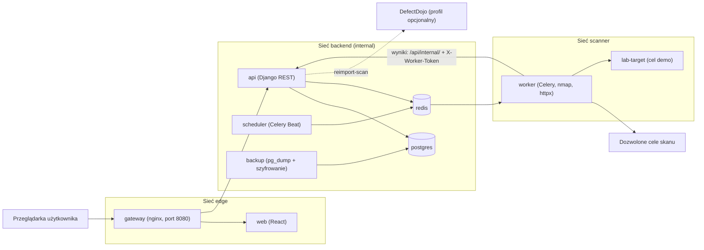

# SurfaceX — dokumentacja techniczna

Rozwiązanie zadania **„Attack Surface Intelligence”** (Centrum Bezpieczeństwa Informacji AGH, HackNation 2026).

| | |
|---|---|
| Nazwa rozwiązania | SurfaceX |
| Zespół | Molekuły — Mateusz Socko, Mikolaj, markus-smile, Maciejbe04 (autorzy wg historii Git) |
| Repozytorium | https://github.com/Maciejbe04/attack-surface-intelligence |
| Wersja | 0.1.0 (prototyp konkursowy) |
| Uruchomienie | lokalnie, `docker compose up` — instrukcja w rozdziale 4 |

Spis treści: [1. Cel](#1-cel-i-zakres) · [2. Architektura](#2-architektura) · [3. Stos](#3-stos-technologiczny) · [4. Uruchomienie](#4-uruchomienie) · [5. Skan](#5-jak-działa-skan) · [6. Bezpieczeństwo skanowania](#6-bezpieczeństwo-skanowania-i-kontrola-intensywności) · [7. Fingerprinting](#7-fingerprinting-technologie-nagłówki-ciasteczka-sygnatury) · [8. Zmiany w czasie](#8-wykrywanie-zmian-w-czasie) · [9. Dashboard](#9-dashboard-i-ocena-ciekawości) · [10. Dane](#10-dane-edycja-import-eksport-defectdojo) · [11. RBAC](#11-role-i-uprawnienia-rbac) · [12. Ochrona danych](#12-ochrona-danych) · [13. Konfiguracja](#13-konfiguracja) · [14. Testy](#14-testy-i-weryfikacja) · [15. Mapa wymagań](#15-mapa-wymagań-zadania) · [16. Ograniczenia](#16-znane-ograniczenia) · [17. Licencje i AI](#17-licencje-i-wykorzystanie-ai) · [18. Dokumenty szczegółowe](#18-dokumenty-szczegółowe)

## 1. Cel i zakres

SurfaceX to narzędzie dla zespołu bezpieczeństwa do cyklicznego, bezpiecznego discovery dużej sieci. Dla zapisanych celów (IP, CIDR, domeny):

- wykrywa aktywne hosty i otwarte usługi (nmap);
- zbiera dane HTTP/HTTPS: tytuł, kod odpowiedzi, nagłówki, ciasteczka, certyfikat TLS, przekierowania (ProjectDiscovery httpx);
- rozpoznaje technologie, CMS-y i serwery oraz dopasowuje własne, deklaratywne sygnatury;
- porównuje kolejne przebiegi i oznacza obserwacje jako `NEW`, `CHANGED`, `MISSING`, `FLAKY`, `GONE`;
- pozwala ręcznie opisać i skorygować wynik (tagi, notatki, nadpisania), a korekta przeżywa kolejne skany;
- eksportuje wyniki do JSON/CSV i automatycznie wysyła je do DefectDojo;
- rozdziela uprawnienia na cztery role i szyfruje wrażliwe dowody skanów.

Skaner wykonuje **wyłącznie rozpoznanie**: nie loguje się do usług, nie zgaduje haseł, nie eksploatuje podatności i nie śledzi przekierowań.

## 2. Architektura



### Usługi Compose

| Usługa | Obraz | Rola |
|---|---|---|
| `gateway` | `surfacex-gateway` (nginx) | jedyny port SurfaceX wystawiony na hoście (`8080`); serwuje UI, przekazuje `/api/` i `/admin/`; blokuje `/api/internal/` |
| `web` | `surfacex-web` (nginx) | statyczny bundle React/TypeScript |
| `api` | `surfacex-api` (Django, Gunicorn) | REST API, RBAC, walidacja, normalizacja wyników, diff, eksport, audyt; przy starcie wykonuje migracje i tworzy konto administratora |
| `scheduler` | `surfacex-api` (Celery Beat) | co 60 s zleca reconcile kolejki i uruchomienie należnych harmonogramów |
| `worker` | `surfacex-worker` (Celery) | wykonuje `nmap` i `httpx`, dopasowuje sygnatury; jedyna usługa z ruchem do skanowanych sieci |
| `postgres` | `postgres:15-alpine` | trwałe dane (wolumen `postgres_data`) |
| `redis` | `redis:7-alpine` | kolejka Celery i cache; bez trwałości — źródłem prawdy jest PostgreSQL |
| `backup` | `surfacex-api` | cykliczny, zaszyfrowany `pg_dump` do wolumenu `backup_data` |
| `lab-target` | `surfacex-lab-target` (nginx) | wbudowany cel demonstracyjny `172.30.0.10` (HTTP 80/8080, TLS 443) |
| `defectdojo*` | DefectDojo 3.5.202 | opcjonalny profil `defectdojo`: nginx (port `8081`), uWSGI, Celery, PostgreSQL, Valkey |

### Sieci i separacja

| Sieć | Usługi | Uwagi |
|---|---|---|
| `edge` | gateway, web, nginx DefectDojo | ruch z hosta |
| `backend` (`internal`) | gateway, api, scheduler, worker, postgres, redis, backup | brak wyjścia na zewnątrz |
| `scanner` (`172.30.0.0/24`) | worker, lab-target | wyjście do skanowanych celów |
| `defectdojo` (`internal`) | usługi DefectDojo | oddzielna baza i broker |

Zasady, które wynikają z `compose.yml`:

- worker **nie zna hasła PostgreSQL** — dostaje tylko sekret `worker_token` i odsyła wyniki do API przez `/api/internal/` z nagłówkiem `X-Worker-Token`; gateway zwraca dla tej ścieżki `404`;
- worker działa z `cap_drop: ALL` i jedyną zdolnością `NET_RAW` (skan SYN); żadna usługa nie montuje socketu Dockera;
- wszystkie usługi mają `no-new-privileges`, limity pamięci i procesów; gateway, web, api, scheduler, worker, redis, lab-target i backup mają system plików tylko do odczytu;
- PostgreSQL i Redis nie publikują portów na hoście.

Szczegóły: [architecture.md](architecture.md).

## 3. Stos technologiczny

| Warstwa | Technologia |
|---|---|
| Silnik skanowania | nmap (C/C++), ProjectDiscovery httpx v1.6.9 (Go, budowany ze źródeł) |
| Orkiestracja i API | Python 3.12, Django 5.1, Django REST Framework 3.15, Gunicorn |
| Kolejka zadań | Celery 5.4 + Redis 7, Celery Beat |
| Baza danych | PostgreSQL 15 |
| Frontend | React 19, TypeScript 5.7, Vite 6 |
| Kryptografia | `cryptography` (AES-256-GCM), Argon2id (`argon2-cffi`), TOTP (`pyotp`) |
| Uruchomienie | Docker Compose; obrazy `linux/amd64` i `linux/arm64` (`docker buildx bake`) |
| Integracja | DefectDojo 3.5.202 (API v2, `reimport-scan`) |

Ruch sieciowy generują natywne narzędzia (nmap, httpx); Python wyłącznie je uruchamia, ogranicza i normalizuje ich wynik. Pełna lista zależności i licencji: [ai-and-dependencies.md](ai-and-dependencies.md).

## 4. Uruchomienie

### Wymagania

- Git oraz Docker Engine lub Docker Desktop z wtyczką Compose (Linux, macOS, Windows + WSL2);
- zalecane ≥ 8 GB RAM i ≥ 5 GB wolnego miejsca; profil DefectDojo potrzebuje dodatkowo ok. 3–4 GB RAM;
- `openssl` (generowanie sekretów; skrypt ma zapasową ścieżkę przez kontener `alpine`);
- wolne porty hosta: `8080` (SurfaceX), `8081` (DefectDojo), `18088` (lab-target).

### Kroki

```bash
git clone https://github.com/Maciejbe04/attack-surface-intelligence.git
cd attack-surface-intelligence
cp .env.example .env
./scripts/preflight.sh        # sprawdza Dockera, architekturę, RAM, dysk i port
./scripts/init-secrets.sh     # generuje pliki sekretów w secrets/ (0600)
docker compose up --build -d
./scripts/smoke-test.sh       # health, baza, logowanie, listy targets/scans/groups
```

Pierwszy build trwa kilka minut (httpx jest kompilowany ze źródeł). Na Windows uruchom `init-secrets.sh` **przed** pierwszym `docker compose up` — szczegóły w [local-platforms.md](local-platforms.md) i [`secrets/README.md`](../secrets/README.md).

### Oczekiwany stan

`docker compose ps` pokazuje wszystkie usługi z healthcheckiem jako `healthy`, a `smoke-test.sh` kończy się komunikatem `smoke PASSED`.

| Co | Adres | Konto lokalne |
|---|---|---|
| SurfaceX (UI i API) | http://localhost:8080 | `admin` / `changeme` |
| Health API | http://localhost:8080/api/health/ | — |
| DefectDojo | http://localhost:8081 | `admin` / `changeme` |
| Cel demonstracyjny | http://localhost:18088 | — |

Konto `admin` / `changeme` służy wyłącznie do lokalnego uruchomienia. Przed udostępnieniem instancji ustaw w `.env` własne `BOOTSTRAP_ADMIN_PASSWORD`, a dla DefectDojo `DEFECTDOJO_ADMIN_PASSWORD=... ./scripts/init-secrets.sh`.

Przy starcie API tworzy dane demonstracyjne: cel `lab-target.surfacex.local` i `172.30.0.10`, wpisy allowlisty i grupę `lab-local` (`SEED_LAB_TARGET=1`) oraz tydzień przykładowej historii pod wykres „Changes over time” (`SEED_DEMO_CHART=1`). Oba ustawienia można wyłączyć w `.env`.

### Warianty i problemy

| Sytuacja | Rozwiązanie |
|---|---|
| Port `8080` zajęty | `GATEWAY_HTTP_PORT=18080` w `.env` |
| Bez DefectDojo | usuń `COMPOSE_PROFILES=defectdojo` z `.env` |
| DefectDojo nie wstaje | `./scripts/doctor-defectdojo.sh`, potem `./scripts/start-defectdojo.sh` |
| Zatrzymanie bez utraty danych | `docker compose down` |
| Pełny reset danych (**usuwa wolumeny**) | `docker compose down -v` |

Runbooki: [operations.md](operations.md), [backup-restore.md](backup-restore.md).

## 5. Jak działa skan

### Moduły

Użytkownik wybiera moduły skanu na Dashboardzie; każdy ma walidowane filtry (`backend/apps/scans/modules.py`).

| Moduł | Narzędzie | Co robi |
|---|---|---|
| `host-discovery` | nmap `-sn` | wykrywa aktywne hosty: ICMP echo (`-PE`) i/lub TCP SYN ping (`-PS80,443`) |
| `port-scan` | nmap `-sS` / `-sT` | skan portów TCP wg profilu; opcja dołączenia portów IoT/OT |
| `service-detect` | nmap `-sV` | nazwa usługi, produkt i wersja |
| `http-fingerprint` | httpx | tytuł, kod, serwer, nagłówki, ciasteczka, favicon, technologie |
| `tls-cert` | httpx `-tls-grab` | certyfikat TLS (podmiot, wystawca, ważność) |
| `signatures` | silnik własny | dopasowanie sygnatur YAML do odpowiedzi HTTP |
| `passive-discovery` | crt.sh, RDAP | pasywne źródła: nazwy z Certificate Transparency i dane RDAP |
| `full-pipeline` | nmap + httpx + sygnatury | cały łańcuch jednym kliknięciem; nie łączy się z innymi modułami |

Profile portów: `discovery-fast` (31 typowych portów, domyślny), `discovery-web` (11 portów WWW), `discovery-full` (top 1000 nmap), `custom` (do 1000 portów). Dokładne listy: [scanning-policy.md](scanning-policy.md).

### Przepływ

1. **Wejście.** Cele trafiają do systemu z formularza albo z pliku TXT/CSV/JSON. Każdy adres jest normalizowany (`validation.py`) i sprawdzany z allowlistą.
2. **Kolejkowanie.** Start skanu tworzy `ScanRun` ze snapshotem modułów i terminem końca okna oraz po jednym `ScanBatch` na cel. Batche trafiają do kolejki Redis; PostgreSQL pozostaje źródłem prawdy.
3. **Wykonanie.** Worker pobiera batch (`claim`); API ponownie sprawdza allowlistę (dla domen także po rozwiązaniu DNS). Worker uruchamia nmap, z otwartych portów buduje listę endpointów HTTP/HTTPS, przekazuje ją do httpx, a na końcu dopasowuje sygnatury.
4. **Wynik.** Worker odsyła wynik do API. API zapisuje obserwacje (host, port, HTTP, technologia, certyfikat, sygnatura), szyfruje dowody i liczy cykl życia względem poprzedniego ukończonego przebiegu.
5. **Po skanie.** Dashboard pokazuje podsumowanie i ocenę ciekawości, a ukończony przebieg jest automatycznie wysyłany do DefectDojo.

### Wielowątkowość i podział pracy

- Jednostką pracy jest batch = jeden cel (IP, domena albo zakres CIDR do 4096 adresów). Batche są niezależne i idempotentne: każdy ma `delivery_id`, a wynik z nieaktualnej kopii zadania jest odrzucany.
- Worker Celery przetwarza równolegle `WORKER_CONCURRENCY` batchy (domyślnie 2); liczbę kontenerów można zwiększyć: `docker compose up -d --scale worker=4`.
- W obrębie batcha równoległością zarządzają same narzędzia, w granicach limitów tempa z rozdziału 6.
- Jeden przebieg obejmuje do 10 000 celów, więc zakres ponad 10 000 adresów IP opisuje się listą podsieci (np. 40 wierszy `/24` = 10 240 adresów). Zalecany rozmiar pojedynczego celu przy skanie portów to `/24` — patrz [ograniczenia](#16-znane-ograniczenia).
- Reconciler (co 60 s) ponownie publikuje batche osierocone po restarcie Redis lub workera, więc utrata kolejki nie gubi skanu.

### Czas trwania skanu

Każdy przebieg ma `started_at`, `finished_at`, postęp w procentach i `eta_seconds` — prognozę liczoną z wygładzonego (EWMA) tempa kończenia batchy. Konsola aktywności pokazuje na żywo komendy uruchamiane przez worker i czas kolejnych etapów.

### Okno czasowe i harmonogram

- Każdy skan ma **obowiązkowe okno**: domyślnie 3600 s (`SCAN_DEFAULT_WINDOW_SECONDS`). Role inne niż `admin` nie przekroczą 1 h; `admin` może ustawić do 24 h (UI oferuje 30 min, 1 h, 2 h).
- Po przekroczeniu okna niedokończone batche przechodzą w `PAUSED`, worker w ciągu kilku sekund kończy procesy nmap/httpx (SIGTERM, po 5 s SIGKILL na całą grupę procesów), a spóźniony wynik jest odrzucany (HTTP 409). Przebieg dostaje status `partial` z flagą „Resume available”.
- **Resume** wznawia wyłącznie wstrzymane batche w nowym oknie — ukończona praca nie jest powtarzana.
- Grupę celów można skanować cyklicznie: co N godzin (1–168), codziennie albo co tydzień o wskazanej godzinie UTC. Jeśli poprzedni przebieg z harmonogramu jeszcze trwa, termin jest pomijany, więc skany się nie nakładają. Szczegóły: [groups-schedules.md](groups-schedules.md).

## 6. Bezpieczeństwo skanowania i kontrola intensywności

### Co wolno skanerowi

- ping i skan portów TCP, identyfikacja usług `-sV` (bez `-A` i bez skryptów NSE);
- pojedyncze żądania `GET` do wykrytych endpointów HTTP/HTTPS oraz pobranie favicony i certyfikatu TLS;
- zapytania do publicznych crt.sh i rdap.org (moduł pasywny).

Skaner nie loguje się do usług, nie wysyła formularzy, nie zgaduje haseł i nie eksploatuje podatności. **Przekierowania nie są śledzone** — odpowiedź `3xx` i nagłówek `Location` są zapisywane jako obserwacja, ale skaner nie podąża pod adres, który mógłby leżeć poza zatwierdzonym zakresem.

### Allowlista

Allowlista jest globalną polityką systemu (IP, CIDR, domena wraz z subdomenami). Cel spoza allowlisty jest odrzucany przy zapisie, przy imporcie, przy starcie skanu i ponownie w chwili pobrania zadania przez worker. W API zarządzają nią `admin` i `operator` (w interfejsie formularz edycji widzi `admin`, pozostałe role mają podgląd), a każda zmiana trafia do audytu. Pusta allowlista nie ogranicza zakresu — przed pracą na realnej sieci trzeba dodać wpisy. Ustawienie `SCAN_ALLOWLIST_ENFORCE_RESOLVED_IP=1` dodatkowo wymaga, by adres IP rozwiązany z domeny mieścił się w zatwierdzonych zakresach.

### Limity

Limity w kolumnie „Sufit” są twarde: obowiązują niezależnie od tego, co użytkownik wpisze w UI lub wyśle do API (`runner.py`, test `test_intensity_caps.py`).

| Parametr | Domyślnie | Sufit (zmienna środowiskowa) |
|---|---|---|
| Tempo nmap (`--max-rate`, pakiety/s) | 200 | 1000 (`SCAN_MAX_RATE_CEILING`) |
| Szablon czasowy nmap | `-T3` | `-T4` tylko przy `SCAN_ALLOW_AGGRESSIVE_TIMING=1` |
| Intensywność `-sV` | 5 | 7 (`SCAN_VERSION_INTENSITY_CEILING`) |
| Ponowienia nmap / httpx | 1 / 1 | stałe |
| Tempo httpx (żądania/s) | 50 | 150 (`SCAN_HTTPX_RATE_CEILING`) |
| Wątki httpx | ≤ 50 | 50 (`SCAN_HTTPX_THREADS_CEILING`) |
| Timeout żądania HTTP | 5 s | 30 s |
| Czas jednego uruchomienia nmap lub httpx | 180 s | stały |
| Wyjście narzędzia / wynik batcha | 2 MiB / 1,8 MiB | stałe |
| Obserwacje z jednego batcha | 2000 | stałe |
| Okno skanu | 1 h | 1 h (role inne niż admin), 24 h (admin) |
| Cele w jednym skanie / imporcie | — | 10 000 |
| Rozmiar zakresu CIDR | — | 4096 adresów |

Tryb skanu TCP dobiera się automatycznie: SYN (`-sS`), gdy kontener ma działające raw sockets (natywny Linux), w przeciwnym razie TCP connect (`-sT`, Docker Desktop). Użyty tryb i pełna linia poleceń są zapisane w wyniku batcha i widoczne w konsoli. Szczegóły: [scanning-policy.md](scanning-policy.md), [security.md](security.md).

## 7. Fingerprinting, technologie, nagłówki, ciasteczka, sygnatury

**Dane HTTP/HTTPS** (httpx): tytuł strony, kod odpowiedzi, nagłówek `Server`, komplet nagłówków odpowiedzi, ciasteczka, hash favicony, fragment treści strony, certyfikat TLS. Przekierowanie widać jako kod `3xx` z nagłówkiem `Location`.

**Technologie** pochodzą z trzech źródeł:

| Źródło | Przykład | Pewność |
|---|---|---|
| httpx `-tech-detect` (reguły Wappalyzer) | WordPress, PHP, nginx, Express | stała 30 (niska) |
| nazwy ciasteczek | `PHPSESSID` → PHP, `JSESSIONID` → Java, `csrftoken` → Django, `laravel_session` → Laravel, `wordpress_*` → WordPress | informacyjna |
| sygnatury własne (YAML) | `wordpress-core`, `nginx-server`, `apache-httpd` | suma wag trafionych reguł, 0–100 |

**Ciekawe nagłówki i ciasteczka** (`http_signals.py`): system zapisuje wszystkie niestandardowe nagłówki (m.in. `Server`, `X-Powered-By`, `X-AspNet-Version`, `X-Generator`, `X-Debug-Token`, `Via`, `X-Backend-Server`), wskazuje brakujące nagłówki bezpieczeństwa (HSTS, CSP, `X-Frame-Options`, `X-Content-Type-Options`) oraz ciasteczka bez flag `HttpOnly`, `Secure` lub `SameSite`. Zapisywana jest nazwa i flagi ciasteczka — **wartości nie są przechowywane w obserwacji**.

**Urządzenia IoT/OT:** opcja `includeIoT` modułu `port-scan` dołącza porty m.in. Modbus (502), S7 (102), DNP3 (20000), BACnet (47808), RTSP (554), MQTT (1883); wystawione protokoły przemysłowe dostają najwyższą ocenę ciekawości.

**Środowiska testowe i panele administracyjne:** adres URL, tytuł strony i nazwa technologii są przeszukiwane pod kątem znaczników `admin`, `login`, `signin`, `staging`, `stage.`, `test.`, `dev.`, `wp-admin`, `phpmyadmin`, `manager`, `console`. Trafienia tworzą na Dashboardzie pozycję „Admin / login / staging hints”.

**Własne sygnatury** to pliki YAML w katalogu `signatures/`. Dozwolone reguły: `header`, `cookie` (tylko nazwa), `html`, `favicon`, `path`, `status`, `versionRegex`. Trafione reguły sumują wagi do wyniku 0–100, a ten przekłada się na poziom `low` (1–39), `medium` (40–69) lub `high` (70–100). Sygnatura nie może zawierać kodu ani wywołań zewnętrznych; wyrażenia regularne mają limit długości wzorca (200 znaków) i wejścia (32 KiB). Dodanie sygnatury: zapisz plik w `signatures/` i przebuduj obrazy (`docker compose up --build -d api worker`). Format i przykłady: [signatures.md](signatures.md).

## 8. Wykrywanie zmian w czasie

Każda obserwacja ma stabilny klucz, np. `host:10.0.0.5`, `port:10.0.0.5:tcp/22`, `http:https://10.0.0.5:443`, `tech:<url>:<technologia>`, `cert:<url>:<podmiot>`, `signature:<endpoint>:<technologia>`. Po zakończeniu przebiegu API porównuje go z **poprzednim ukończonym przebiegiem o tym samym zestawie modułów i tej samej grupie albo identycznej liście celów**.

| Stan | Kiedy |
|---|---|
| `NEW` | klucza nie było w poprzednim przebiegu |
| `CHANGED` | klucz istnieje, ale zmienił się dowolny atrybut (np. wersja, tytuł, nagłówki) |
| `UNCHANGED` | bez zmian |
| `MISSING` | pierwszy pełny przebieg bez odpowiedzi |
| `FLAKY` | drugi kolejny brak **albo** powrót po okresie nieobecności — host lub usługa niestabilna |
| `GONE` | trzeci kolejny pełny przebieg bez odpowiedzi |

Reguły chroniące przed fałszywymi alarmami:

- stany `MISSING` / `FLAKY` / `GONE` powstają tylko po przebiegu **ukończonym w całości**; przebieg częściowy, anulowany lub wstrzymany oknem czasowym nie obniża stanu;
- licznik braków (`miss_streak`) jest przenoszony między przebiegami i zeruje się, gdy obserwacja wraca;
- host nie jest więc raportowany jako nieaktywny po jednym braku odpowiedzi — dopiero trzeci kolejny pełny pomiar daje `GONE`.

Porównanie dwóch przebiegów (dodane, usunięte, zmienione z wartościami „przed” i „po”) udostępnia `GET /api/scans/{id}/diff/` oraz przycisk **Compare** w zakładce Scans. Model danych: [data-model.md](data-model.md).

## 9. Dashboard i ocena ciekawości

Interfejs (React, język polski lub angielski, tryb ciemny i wysokiego kontrastu) ma zakładki: **Dashboard**, **Targets**, **Groups**, **Scans**, **Allowlist**, **Users** (tylko `admin`) i **System** (integracje, wersje komponentów, dziennik audytu dla `admin`). Elementy, do których rola nie ma prawa, są ukrywane, a uprawnienia i tak egzekwuje API.

Dashboard pokazuje:

- **Ciekawość (Curiosity)** — najważniejsze znaleziska ostatniego skanu: liczbę hostów z otwartymi portami, porty wrażliwe i niestandardowe, wskazówki paneli administracyjnych i środowisk testowych, technologie o średniej i wysokiej pewności, certyfikaty wygasające w ciągu 30 dni, najczęstsze usługi;
- **Changes over time** — wykres liczby obserwacji `NEW` / `CHANGED` / `MISSING` / `FLAKY` / `GONE` w zakresie 24 h, 7 dni, 30 dni lub całej historii;
- **Latest findings** oraz **konsolę aktywności** bieżącego skanu z postępem i ETA.

Ocena ciekawości portu: `high` — zdalny dostęp, bazy danych, API Dockera i protokoły przemysłowe (FTP, SSH, Telnet, SMB, RDP, VNC, MySQL, PostgreSQL, Redis, MongoDB, MSSQL, Oracle, Modbus, S7, DNP3, BACnet); `medium` — poczta, LDAP, alternatywne porty HTTP, Elasticsearch, Memcached; `info` — DNS, HTTP, HTTPS; pozostałe otwarte porty `low`. Instrukcja obsługi krok po kroku: [instrukcja-uzytkownika.md](instrukcja-uzytkownika.md).

## 10. Dane, edycja, import, eksport, DefectDojo

### Trwała edycja wyników

Wynik skanera jest niemutowalny. Korekta użytkownika to osobny rekord `ManualOverride` przypięty do klucza obserwacji: tagi, notatka (szyfrowana) i nadpisania atrybutów. Widok w UI to obserwacja połączona z aktywną korektą. Ponieważ korekta jest przypięta do klucza, a nie do przebiegu, **kolejny skan jej nie usuwa** i można ją edytować niezależnie od stanu skanu. Korekty są wspólne dla zespołu; edytować mogą `admin`, `operator` i `analyst`.

### Import

| Co | Jak | Limit |
|---|---|---|
| Cele: ręcznie | formularz w zakładce Targets | pojedynczy IP, CIDR lub domena |
| Cele: plik | `POST /api/targets/import/` — TXT (adres w linii), CSV (`value`/`address`/`host`, opcjonalnie `type`, `comment`, `group`), JSON (`targets[]`) | 10 000 celów, 5 MiB |
| Wyniki skanów | `POST /api/observations/import/` — JSON w formacie eksportu `surfacex.export.v1` | — |

Import celów może od razu przypisać je do grupy i uruchomić skan wybranymi modułami. Cele z pliku przechodzą tę samą walidację i allowlistę co wpisane ręcznie. Zaimportowane wyniki trafiają do tych samych tabel co wyniki skanera, ze źródłem `import`.

### Eksport

`GET /api/scans/{id}/export/?format=json|csv` (przyciski **Export JSON** / **Export CSV**). JSON ma pole `schema: "surfacex.export.v1"`, metadane przebiegu i listę obserwacji; schemat: [`schemas/surfacex.export.v1.json`](../schemas/surfacex.export.v1.json). CSV zawiera kolumny `entity_type`, `entity_key`, `lifecycle`, `target_address`, `source`, `miss_streak`, `attrs_json`. Każdy eksport jest odnotowany w audycie. Formaty i przykłady: [import-export.md](import-export.md).

### DefectDojo

Po zakończeniu skanu z co najmniej jednym ukończonym batchem SurfaceX automatycznie wysyła raport do DefectDojo (`POST /api/v2/reimport-scan/`, typ `Generic Findings Import`). Product Type, Product, Engagement i Test są tworzone automatycznie. Findings obejmują aktywne hosty, otwarte usługi (z produktem i wersją) oraz technologie. Poziom domyślny to `Info`; dla otwartych usług wynika z oceny ciekawości portu. Stabilny `unique_id_from_tool` sprawia, że kolejny eksport aktualizuje istniejące findings, zamiast je dublować. Status wysyłki widać na liście skanów; ręczny eksport: `POST /api/scans/{id}/export/defectdojo/`. Zewnętrzną instancję wskazują `DEFECTDOJO_URL` i `DEFECTDOJO_API_TOKEN`.

Pełna lista endpointów: [api.md](api.md).

## 11. Role i uprawnienia (RBAC)

| Rola z zadania | Rola w SurfaceX | Zakres |
|---|---|---|
| Administracja | `admin` | wszystko poniżej oraz użytkownicy i role, dziennik audytu, okno skanu dłuższe niż 1 h |
| Dodawanie, usuwanie, modyfikacja | `operator` | cele, grupy, harmonogramy, allowlista, start / anulowanie / wznowienie skanu, import celów |
| Modyfikacja i odczyt | `analyst` | edycja znalezisk (tagi, notatki, nadpisania), import wyników, eksport JSON/CSV i do DefectDojo |
| Odczyt | `viewer` | wyłącznie podgląd |

- Uprawnienia egzekwuje API (klasy `IsAdmin`, `IsAdminOrOperator`, `CanExportFindings`): brak sesji daje `401`, brak uprawnienia `403`. UI jedynie ukrywa niedostępne akcje.
- Administrator tworzy konta, przypisuje i zmienia role, blokuje i usuwa użytkowników (zakładka Users, `/api/auth/users/`). Nie może odebrać roli ani zablokować własnego konta.
- Dane są wspólne dla zespołu: wszyscy widzą te same cele, skany i wyniki, a rola decyduje, co wolno zmienić.
- Logowanie: hasło (Argon2id) i sesja w ciasteczku `HttpOnly`; opcjonalne MFA TOTP ([auth-mfa.md](auth-mfa.md)).

Pełna macierz: [rbac.md](rbac.md).

## 12. Ochrona danych

| Obszar | Mechanizm |
|---|---|
| Dowody skanów (`FingerprintEvidence.ciphertext`) | AES-256-GCM, klucz z sekretu `app_data_key` |
| Notatki analityka (`ManualOverride.notes_ciphertext`) | AES-256-GCM |
| Hasła użytkowników | Argon2id |
| Backup bazy | `pg_dump` szyfrowany AES-256-CBC + PBKDF2 osobnym kluczem `backup_key` |
| Sekrety | pliki `secrets/*` z uprawnieniami `0600`, montowane tylko do usług, które ich potrzebują; poza Gitem |
| Dziennik audytu | logowania nieudane, cele, grupy, harmonogramy, allowlista, skany (start, anulowanie, wznowienie), eksporty, importy wyników, korekty, użytkownicy |

Szyfrogram ma postać `sx1:` + base64url(nonce 12 B ‖ szyfrogram ‖ tag GCM). Pola potrzebne do wyszukiwania i porównań (adres, port, usługa, tytuł, kod, nazwa technologii, nazwy nagłówków i ciasteczek) pozostają jawne. Zakres i granice szyfrowania: [encryption.md](encryption.md); model zagrożeń: [security.md](security.md).

## 13. Konfiguracja

Zmienne ustawia się w `.env` (wzór: `.env.example`).

| Zmienna | Domyślnie | Znaczenie |
|---|---|---|
| `GATEWAY_HTTP_PORT` | `8080` | port UI/API na hoście |
| `DEFECTDOJO_HTTP_PORT` / `LAB_HTTP_PORT` | `8081` / `18088` | porty DefectDojo i celu demo |
| `COMPOSE_PROFILES` | `defectdojo` | usuń, by nie uruchamiać DefectDojo |
| `BOOTSTRAP_ADMIN_USER` / `BOOTSTRAP_ADMIN_PASSWORD` | `admin` / `changeme` | konto tworzone przy starcie |
| `WORKER_CONCURRENCY` | `2` | równoległe batche na kontener workera |
| `SCAN_DEFAULT_WINDOW_SECONDS` | `3600` | domyślne okno skanu |
| `SCAN_MAX_RATE_CEILING`, `SCAN_VERSION_INTENSITY_CEILING`, `SCAN_HTTPX_RATE_CEILING`, `SCAN_HTTPX_THREADS_CEILING` | `1000`, `7`, `150`, `50` | twarde sufity intensywności |
| `SCAN_ALLOW_AGGRESSIVE_TIMING` | `0` | `1` dopuszcza nmap `-T4` |
| `SCAN_ALLOWLIST_ENFORCE_RESOLVED_IP` | `0` | `1` wymaga, by IP domeny mieściło się w allowliście |
| `SCAN_RECONCILE_INTERVAL_SECONDS` / `SCAN_RECONCILE_STALE_SECONDS` | `60` / `600` | odtwarzanie osieroconych batchy |
| `CSRF_PROTECT`, `SECURE_COOKIES` | `0`, `0` | ustaw `1` przy wdrożeniu za HTTPS |
| `SEED_LAB_TARGET`, `SEED_DEMO_CHART` | `1`, `1` | dane demonstracyjne przy starcie |
| `DEFECTDOJO_URL`, `DEFECTDOJO_API_TOKEN` | lokalny profil | zewnętrzna instancja DefectDojo |
| `HTTPX_VERSION` | `v1.6.9` | wersja httpx budowana w obrazie workera |

## 14. Testy i weryfikacja

```bash
# testy jednostkowe i API (97 testów), w działającym stosie
docker compose exec -T api python manage.py test apps --settings=config.settings_test

# test dymny działającej instancji
./scripts/smoke-test.sh

# backup i test odtworzenia do tymczasowej bazy
./scripts/backup.sh && ./scripts/restore-test.sh
```

Testy obejmują m.in. API skanów i grup, import, cykl życia obserwacji, korekty i allowlistę, sufity intensywności, moduł pasywny, wspólną przestrzeń zespołu i logikę workera. Stan na 22.11.2026: 97 testów przechodzi, `smoke-test.sh` kończy się `smoke PASSED`.

Powtarzalny scenariusz dwóch skanów ze zmianą środowiska (laboratorium 7 kontenerów, `./demo/lab/lab.sh up` → skan → `./demo/lab/lab.sh mutate` → skan): [demo-script.md](demo-script.md).

## 15. Mapa wymagań zadania

Numeracja jak w rozdziale 2 treści zadania.

| # | Wymaganie | Realizacja |
|---|---|---|
| 1 | Wczytanie IP, CIDR, domen | formularz Targets; import TXT/CSV/JSON; walidacja i normalizacja (IPv4/IPv6, IDN) |
| 2 | Bezpieczny, wielowątkowy skan; czas trwania; podział na podgrupy | Celery + nmap/httpx; batch na cel, równoległe workery; `started_at`, postęp, ETA; limity z rozdz. 6 |
| 3 | Aktywne hosty | nmap: ICMP echo, TCP SYN ping, skan portów |
| 4 | Podstawowe usługi | nmap `-sV`: usługa, produkt, wersja |
| 5 | Dane HTTP/HTTPS | httpx: tytuł, kod, nagłówki, ciasteczka, certyfikat TLS; przekierowanie zapisane jako `3xx` + `Location` (bez podążania) |
| 6 | Technologie: CMS, framework, serwer, IoT | httpx tech-detect, mapowanie ciasteczek, sygnatury, profil portów IoT/OT |
| 7 | Staging, panel administracyjny | znaczniki w URL, tytule i technologii → „Admin / login / staging hints” |
| 8 | Porównanie przebiegów | `GET /api/scans/{id}/diff/`, przycisk Compare |
| 9 | Nowe, znikające, zmienione usługi | stany `NEW`, `CHANGED`, `MISSING`, `FLAKY`, `GONE` |
| 10 | Własne sygnatury | pliki YAML w `signatures/` |
| 11 | Formularz + plik CSV/JSON, ten sam proces | wspólna walidacja, allowlista i kolejka dla obu ścieżek |
| 12 | RBAC | uprawnienia w API; administrator zarządza kontami i rolami |
| 13 | Cztery role | `admin`, `operator`, `analyst`, `viewer` |
| 14 | Edycja niezależna od skanu, zachowana przy kolejnych | `ManualOverride` przypięty do klucza obserwacji |
| 15 | Czytelny interfejs i dashboard | React UI: Curiosity, Changes over time, Latest findings, konsola |
| 16 | Szyfrowanie danych wrażliwych w spoczynku | AES-256-GCM dla dowodów i notatek; szyfrowany backup |

Zakres dodatkowy („mile widziany”): harmonogram cyklicznych skanów ✔ · ocena ciekawości ✔ · obsługa hostów niestabilnych (`FLAKY`, licznik braków) ✔ · fingerprinting HTTP/HTTPS ✔ · wykrywanie CMS-ów i technologii ✔ · tagi ✔ · eksport do DefectDojo ✔ · wizualizacja zmian w czasie ✔ · pasywne źródła danych (crt.sh, RDAP) ✔ · grupowanie celów w grupy ✔ · porównanie zależne od pory dnia — nie zaimplementowano.

## 16. Znane ograniczenia

Prototyp powstał w 24 godziny. Poniższe ograniczenia są świadome i jawne.

**Skanowanie**

- Duży zakres CIDR nie jest automatycznie dzielony na podsieci. Batch to jeden cel, a pojedyncze uruchomienie nmap ma limit 180 s, dlatego przy skanie portów zalecany rozmiar celu to `/24`; większe zakresy należy importować jako listę podsieci. Zakres CIDR może mieć najwyżej 4096 adresów.
- Skan wstrzymany końcem okna wznawia się przyciskiem **Resume** (albo startuje od nowa w kolejnym terminie harmonogramu); automatyczne wznowienie w następnym oknie nie jest zaimplementowane.
- Przekierowania nie są śledzone, więc treść strony docelowej przekierowania nie jest analizowana. Filtry `followRedirects` i `maxRedirects` modułu `http-fingerprint` są ignorowane.
- httpx odpytuje adres główny każdego endpointu. Reguła sygnatury typu `path` (np. `/wp-login.php`) trafia tylko wtedy, gdy ta ścieżka jest częścią badanego adresu; filtr `pathsExtra` nie jest jeszcze używany.
- W fazie skanu portów nmap działa z `-Pn`, żeby nie pomijać hostów blokujących ping. W tym trybie o aktywności hosta świadczą jego otwarte porty; samą osiągalność (ICMP, TCP ping) sprawdza moduł `host-discovery`.

**Funkcje**

- Sygnatury są plikami wczytywanymi przy starcie procesu — nie ma edytora w UI, a zmiana wymaga przebudowania obrazów.
- Zestaw czterech ról jest stały; nie można definiować własnych ról.
- Zapisanego celu nie da się edytować — trzeba go usunąć i dodać ponownie.
- Wyniki importuje się tylko w formacie JSON `surfacex.export.v1`; CSV służy do eksportu.
- Wyniki modułu pasywnego nie trafiają do DefectDojo i nie dodają automatycznie hostów do listy celów.

**Bezpieczeństwo wdrożenia**

- Gateway serwuje HTTP bez TLS, a `CSRF_PROTECT` i `SECURE_COOKIES` są domyślnie wyłączone — konfiguracja jest przeznaczona do pracy lokalnej i w laboratorium. Wdrożenie współdzielone wymaga TLS (reverse proxy) i ustawienia obu zmiennych na `1`.
- Domyślne konto `admin` / `changeme` trzeba zmienić przed udostępnieniem instancji.
- Nie ma limitu prób logowania; nieudane logowania są zapisywane w audycie.
- Sekret TOTP jest przechowywany w bazie bez szyfrowania; nie ma kodów zapasowych.
- Surowy wynik batcha (`ScanBatch.result`), zawierający nagłówki odpowiedzi i fragment treści strony, jest zapisywany jako jawny JSON. Szyfrowane są rekordy dowodów i notatki analityka. Pełną poufność danych na dysku zapewnia dopiero szyfrowanie wolumenu hosta.
- Rotacja klucza `app_data_key` jest ręczna; nie ma wersjonowania kluczy.
- PostgreSQL i Redis działają jako pojedyncze instancje — Compose nie zapewnia wysokiej dostępności.

## 17. Licencje i wykorzystanie AI

Wszystkie zależności są bezpłatne; lista bibliotek, narzędzi, licencji, użytych asystentów AI oraz oświadczenie zgodności z regulaminem zadania: [ai-and-dependencies.md](ai-and-dependencies.md).

## 18. Dokumenty szczegółowe

| Dokument | Zawartość |
|---|---|
| [`README.md`](../README.md) | szybki start i indeks |
| [instrukcja-uzytkownika.md](instrukcja-uzytkownika.md) | obsługa interfejsu krok po kroku |
| [architecture.md](architecture.md) | komponenty, sieci, granice zaufania |
| [api.md](api.md) | endpointy REST i role |
| [data-model.md](data-model.md) | encje, klucze, cykl życia |
| [scanning-policy.md](scanning-policy.md) | zasady i limity skanowania |
| [signatures.md](signatures.md) | format własnych sygnatur |
| [import-export.md](import-export.md) | formaty plików, DefectDojo |
| [groups-schedules.md](groups-schedules.md) | grupy i harmonogramy |
| [passive-discovery.md](passive-discovery.md) | crt.sh i RDAP |
| [rbac.md](rbac.md) · [auth-mfa.md](auth-mfa.md) | role, logowanie, MFA |
| [encryption.md](encryption.md) · [security.md](security.md) | szyfrowanie, model zagrożeń |
| [operations.md](operations.md) · [backup-restore.md](backup-restore.md) | eksploatacja, backup |
| [local-platforms.md](local-platforms.md) | Linux, macOS, Windows; amd64 i arm64 |
| [demo-script.md](demo-script.md) · [`demo/README.md`](../demo/README.md) | scenariusz demonstracji i laboratoria |
| [adr-001-http-fingerprinting.md](adr-001-http-fingerprinting.md) | decyzja: httpx jako silnik HTTP |
| [ai-and-dependencies.md](ai-and-dependencies.md) | licencje, AI, zgodność z regulaminem |
| [mvp-plan.md](mvp-plan.md) | pierwotny plan projektu (dokument historyczny) |
